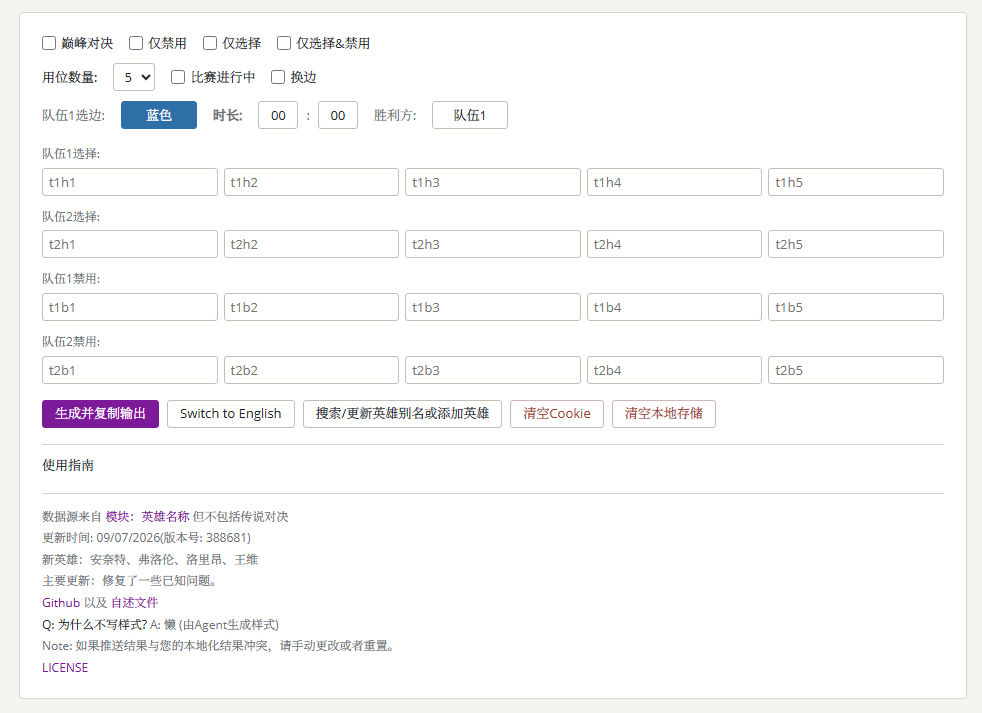
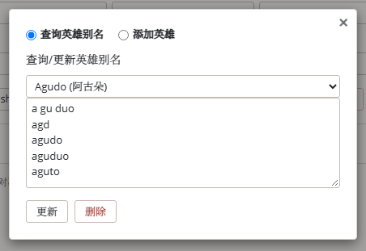
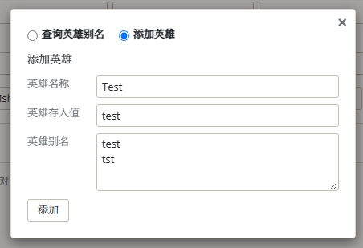

# Low-Code Editor

This Project implements [***Liquipedia***](https://liquipedia.net/honorofkings/)'s *Ban&Picks* formatting output, which reduces the increased inspection cost caused by output errors and improves certain writing efficiency.

#### Page Effect



#### Output effect

##### Standard Output (Deprecated)

``` wikitext
        |team1side=blue|team2side=red|length=99:59|winner=1
        <!-- Hero picks -->
        |t1h1=agudo|t1h2=agudo|t1h3=agudo|t1h4=agudo|t1h5=agudo
        |t2h1=agudo|t2h2=agudo|t2h3=agudo|t2h4=agudo|t2h5=agudo
        <!-- Hero bans-->
        |t1b1=agudo|t1b2=agudo|t1b3=agudo|t1b4=agudo|t1b5=agudo
        |t2b1=agudo|t2b2=agudo|t2b3=agudo|t2b4=agudo|t2b5=agudo
```
##### Standard Output

``` wikitext
        |team1side=blue |team2side=red |length=99:59 |winner=1
        <!-- Hero picks -->
        |t1h1=agudo |t1h2=agudo |t1h3=agudo |t1h4=agudo |t1h5=agudo
        |t2h1=agudo |t2h2=agudo |t2h3=agudo |t2h4=agudo |t2h5=agudo
        <!-- Hero bans-->
        |t1b1=agudo |t1b2=agudo |t1b3=agudo |t1b4=agudo |t1b5=agudo
        |t2b1=agudo |t2b2=agudo |t2b3=agudo |t2b4=agudo |t2b5=agudo
```

##### 5Ban & 5Pick

``` wikitext
        |team1side=blue |team2side=red |length=00:00 |winner=1
        <!-- Hero picks -->
        |t1h1= |t1h2= |t1h3= |t1h4= |t1h5=
        |t2h1= |t2h2= |t2h3= |t2h4= |t2h5=
        <!-- Hero bans-->
        |t1b1= |t1b2= |t1b3= |t1b4= |t1b5=
        |t2b1= |t2b2= |t2b3= |t2b4= |t2b5=
```

##### 4Ban & 5Pick

``` wikitext
        |team1side=blue |team2side=red |length=00:00 |winner=1
        <!-- Hero picks -->
        |t1h1= |t1h2= |t1h3= |t1h4= |t1h5=
        |t2h1= |t2h2= |t2h3= |t2h4= |t2h5=
        <!-- Hero bans-->
        |t1b1= |t1b2= |t1b3= |t1b4=
        |t2b1= |t2b2= |t2b3= |t2b4=
```

##### Ultimate Battle

``` wikitext
        |team1side=blue |team2side=red |length=00:00 |winner=1
        <!-- Hero picks -->
        |t1h1= |t1h2= |t1h3= |t1h4= |t1h5=
        |t2h1= |t2h2= |t2h3= |t2h4= |t2h5=
```

##### Only Need Picks

```wikitext
        <!-- Hero picks -->
        |t1h1= |t1h2= |t1h3= |t1h4= |t1h5=
        |t2h1= |t2h2= |t2h3= |t2h4= |t2h5=
```

##### Only Need 4Bans

```wikitext
        <!-- Hero bans-->
        |t1b1= |t1b2= |t1b3= |t1b4=
        |t2b1= |t2b2= |t2b3= |t2b4=
```

##### Only Need 5Bans

```wikitext
        <!-- Hero bans-->
        |t1b1= |t1b2= |t1b3= |t1b4= |t1b5=
        |t2b1= |t2b2= |t2b3= |t2b4= |t2b5=
```

##### Only Need Ban & Picks

```wikitext
        <!-- Hero picks -->
        |t1h1= |t1h2= |t1h3= |t1h4= |t1h5=
        |t2h1= |t2h2= |t2h3= |t2h4= |t2h5=
        <!-- Hero bans-->
        |t1b1= |t1b2= |t1b3= |t1b4= |t1b5=
        |t2b1= |t2b2= |t2b3= |t2b4= |t2b5=
```

##### Game in Progress

```wikitext
        |team1side=blue |team2side=red |length= |winner=
        <!-- Hero picks -->
        |t1h1= |t1h2= |t1h3= |t1h4= |t1h5=
        |t2h1= |t2h2= |t2h3= |t2h4= |t2h5=
        <!-- Hero bans-->
        |t1b1= |t1b2= |t1b3= |t1b4= |t1b5=
        |t2b1= |t2b2= |t2b3= |t2b4= |t2b5=
```

#### Usage Guide

> **Note** — Open the page through an HTTP server (VS Code **Live Server**, `python -m http.server`, and so on). Browsers refuse to read `data.json` from a `file://` path.

##### 1. Choose a mode
The **Mode** group holds five radio buttons — only one can be selected at a time, and **Standard** is the default:

| Option | Output |
| --- | --- |
| Standard (default) | side/length/winner + picks + bans |
| Ultimate Battle | side/length/winner + picks |
| Bans Only | bans only |
| Picks Only | picks only |
| Bans & Picks | picks + bans |

##### 2. Fill in the match information
- **BanNums** — 4 or 5 bans per team; the extra ban inputs are hidden.
- **Game in Progress** — leaves `length` and `winner` empty.
- **Without Space** — when matching heroes, every space is removed from **both** the text you type and the hero names/aliases, so `flowborn assassin` still matches `Flowborn (Assassin)`.

##### 3. Pick a side and a winner
`Team1Side`, `Winner` and `Change Side` are toggle buttons:

- `Team1Side` — switches between blue and red; Team2 always takes the opposite side
- `Winner` — switches between Team1 and Team2
- `Change Side` — swaps the two teams' entered heroes: `t1h1` ↔ `t2h1`, `t1b1` ↔ `t2b1` and so on. Their blocks also swap places, so the order you typed stays the same on screen — only the team the heroes belong to changes. Team1Side flips to red.

All three values are remembered in a cookie.

##### 4. Enter the length
`MM` and `SS` accept digits only and are zero-padded when the field loses focus. Leaving them empty produces `00:00`.

##### 5. Enter heroes
Each team has five pick slots and up to five ban slots. Type a full hero name **or any alias**, then choose an entry from the suggestion list.

- red border — no hero matched; the value would be empty
- yellow border — several heroes matched; pick one from the list
- highlighted — the same hero is filled into more than one box, and a hint appears below the inputs

##### 6. Keyboard shortcuts
`Tab` / `Shift`+`Tab` move between inputs and buttons. While the hero suggestion list is open, `↑` / `↓` move the highlight, `Enter` confirms the highlighted entry, and `Esc` closes the list.

##### 7. Manage hero aliases
Use **Search/Update Hero Alias or Add Hero** to edit an alias list, add a hero, or delete one. Changes are stored in this browser only and are merged with an updated `data.json` on the next load: your aliases and your own heroes are kept, upstream additions are pulled in, and heroes removed upstream are removed locally. Use **Clear LocalStorage** to reset everything.

##### Local deployment
It is recommended to use [Visual Studio Code](https://code.visualstudio.com/)'s **Live Server** plug-in to deploy this Project. Please understand the inconvenience caused.

##### Alias data format
The BP input box supports prompt words. This Project supports most alias prompts for ***Honor of Kings (including Global services)***. You can also modify them by editing the ***data.json***. Multiple ***aliases*** can be set for one hero; the fields are:

| name  | value              |
| ----- | ------------------ |
| value | Final output value |
| text  | prompt words       |
| alias | alias (DIY)        |

##### Update Online
**Search and Update**

Just create a new line and add the alias you need



**Add**




#### Finally

Due to the rush of time, this Project has many shortcomings. Welcome to raise them to me through Issue!
